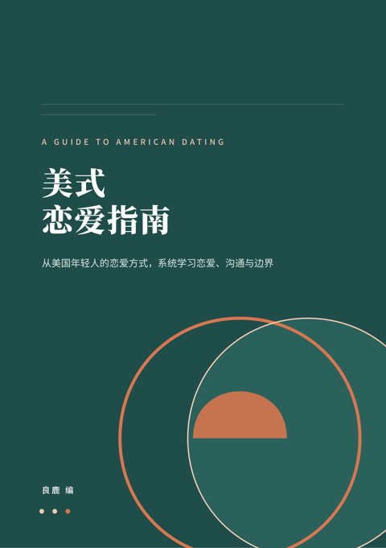

<p align="center"></p>

<h1 align="center">美式恋爱指南</h1>
<p align="center">从美国年轻人的恋爱方式，系统学习恋爱、沟通与边界</p>

<p align="center">
  <a href="../../releases/latest"><b>⬇ 下载 PDF / EPUB</b></a> ·
  <a href="dist/美式恋爱指南.md">在线阅读（Markdown）</a>
</p>

---

## 这本书讲什么

很多人恋爱受挫，是因为把太多赌注压在“表白”这一个瞬间。美国年轻人的恋爱路径提供了另一种思路：**先约会，再确认**——用低成本的约会逐步了解彼此，等双方好感都明确时，再用一次平静的对话把关系定下来。

本书按真实恋爱进程展开，共 19 章 + 3 个附录：

| 部分 | 章节 |
|---|---|
| 第一部分　准备与认识 | 0 总览 · 1 心态与自我准备 · 2 认识渠道 · 3 约会软件实操 · 4 发出与回应邀约 |
| 第二部分　约会与亲密 | 5 第一次约会 · 6 约会之后的跟进 · 7 早期多次约会与 talking stage · 8 身体亲密与同意 · 9 确认关系（DTR） |
| 第三部分　关系的日常与长期 | 10 恋爱中的日常相处 · 11 沟通与矛盾 · 12 见家长与家庭 · 13 同居 · 14 求婚、订婚与婚礼 · 15 分手 |
| 第四部分　跨文化与总复习 | 16 中国人与美国人约会 · 17 总复习与实战 |
| 专题 | 18 身体亲密的渐进与边界（覆盖美国与国内语境） |
| 附录 | A 英文表达索引 · B 求助资源汇总 · C 术语表 |

每章固定包含：本章要点、详细讲解、时间线、中美对比表、实用英文表达、带“潜台词”批注的对话示例、常见误区、安全提醒、练习与参考答案。

## 下载

在 [Releases](../../releases/latest) 页面下载：

- **PDF**：A5 版式，约 350 页，适合手机、平板阅读和打印
- **EPUB**：可在 Apple Books、多看、微信读书等阅读器中打开

## 自行构建

依赖：`pandoc`、`weasyprint`、`pymupdf`，以及思源宋体 / 思源黑体（Noto Serif/Sans CJK SC）。

```bash
pip install weasyprint pymupdf
python3 build.py   # 输出到 dist/
```

源文件在 `src/`（每章一个 Markdown 文件），样式在 `style/`。

## 免责声明

书中对中美约会文化的描述是对常见情况的概括，不代表所有人。涉及法律、移民、医疗与心理健康的内容仅为一般常识，不构成专业建议，具体问题请咨询执业律师、医生或官方机构。如遇危险，请拨打 110（中国）或 911（美国）。

## 许可

本书采用 [CC BY-NC-SA 4.0](https://creativecommons.org/licenses/by-nc-sa/4.0/deed.zh-hans) 许可：可自由转载、改编，但须署名、不得用于商业目的，并以相同方式共享。

© 2026 良鹿
